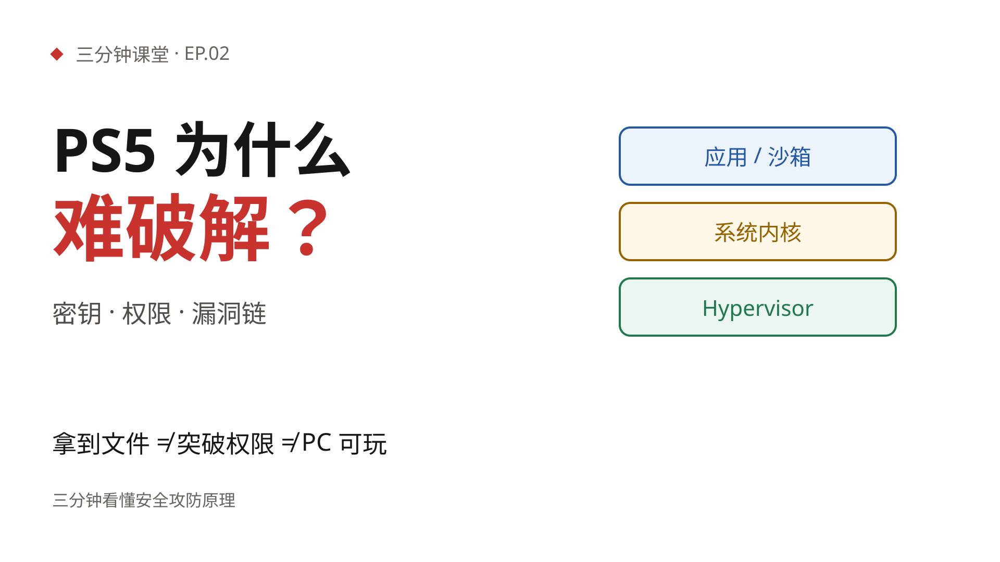

# 三分钟课堂

用 **HTML + TTS + FFmpeg** 做三分钟知识视频。白底、大字、每页一个概念；脚本、配音、画面、字幕、成片全部开源。



## 本期

**EP.02 · PS5 为什么难破解？**

从 PS5 安全角度，讲清加密、签名、许可证、硬件隔离与权限边界；用公开研究说明漏洞链为什么难，再解释“导出游戏”为什么不等于“PC 可玩”。包含中文配音、攻防示意动画与字幕，不包含破解操作或原始聊天。

| | |
|---|---|
| 成片 | [out/ps5-security.mp4](episodes/002-ps5-security/out/ps5-security.mp4) |
| 画面 | [slides/index.html](episodes/002-ps5-security/slides/index.html) |
| 脚本 | [script.md](episodes/002-ps5-security/script.md) |
| 配音 | [audio/narration.m4a](episodes/002-ps5-security/audio/narration.m4a) |
| 字幕 | [subtitles/ps5-security.srt](episodes/002-ps5-security/subtitles/ps5-security.srt) |
| 封面 | [cover/cover.svg](episodes/002-ps5-security/cover/cover.svg) |
| 来源 | [research/sources.md](episodes/002-ps5-security/research/sources.md) |
| 时长 | 约 3 分钟 · 1920 × 1080 · 30fps |

复现：沿用下方流程，将 `EPISODE` 改为 `episodes/002-ps5-security`。本期所有图形均为原创示意，不使用游戏画面；内容不构成对某个固件、游戏或破解期限的保证。

## 往期

**EP.01 · PDF 上的红章，能信吗？**

收到一份带红章的 PDF，怎么判断它不是 P 的？这期用 3 分钟讲清楚：

- 法律为什么只认「可靠的电子签名」
- 星河科技的采购合同：100 万、SHA-256、私钥签名、公钥验签
- CA 到底是谁，怎么实名审核、怎么签发证书
- PDF 签名域里到底写了什么
- Adobe 签名面板和国内验签平台怎么看
- 截图 / 打印件能不能当证据，法院看什么
- 截图、改字、证书过期这三个坑

| | |
|---|---|
| 成片 | [out/pdf-ca-signature.mp4](episodes/001-pdf-ca-signature/out/pdf-ca-signature.mp4) |
| 画面 | [slides/index.html](episodes/001-pdf-ca-signature/slides/index.html) |
| 脚本 | [script.md](episodes/001-pdf-ca-signature/script.md) |
| 配音 | [audio/narration.m4a](episodes/001-pdf-ca-signature/audio/narration.m4a) |
| 字幕 | [subtitles/pdf-ca-signature.srt](episodes/001-pdf-ca-signature/subtitles/pdf-ca-signature.srt) |
| 封面 | [cover/cover.svg](episodes/001-pdf-ca-signature/cover/cover.svg) |
| 时长 | 2 分 43 秒 · 1920 × 1080 · 30fps |

本地预览网页播放器：

```bash
python3 -m http.server 8780 --directory episodes/001-pdf-ca-signature
# 浏览器打开 http://127.0.0.1:8780/slides/
```

## 怎么做出来的

```text
episode.json（逐场旁白）
   ↓  edge-tts 逐场配音 + 句级时间戳
audio/ + manifest.json（场景起点、时长、字幕）
   ↓  HTML/CSS/JS 写画面；同一份 HTML 也是网页播放器
Playwright 把动画 seek 到指定时间 → 截图
   ↓  按字幕切换点补帧；FFmpeg 拼接、加音轨
out/*.mp4 + cover/*.png + subtitles/*.srt
```

**为什么不用录屏**：录屏会遇到动画提前播放、字体晚加载、前几帧状态不对。这里把每段动画定位到绝对时间再截图，同一帧可复现，字幕和画面不会漂。

**为什么字幕直接画进 HTML**：不依赖 FFmpeg 的 libass 字幕滤镜；画面、网页播放器和成片共用同一套排版。

## 目录

```text
PROMPT.md         # 单期制作 brief：白底、大字、口语过渡、验收清单
pipeline/
  tts.py          # edge-tts 逐场配音、拼接音轨、生成时间轴和 SRT
  render.mjs      # Playwright 逐帧截图 + FFmpeg 合成
  cover.mjs       # 封面截图
  preview.mjs     # 快速出几张场景预览图
episodes/
  001-pdf-ca-signature/
    episode.json  # 元数据、场景、旁白
    script.md     # 分镜与口播稿
    research/     # 事实核对笔记
    slides/       # 播放器 + 渲染源（index.html / css / js / data.js）
    audio/        # 逐场 mp3、拼接后的 m4a、manifest
    subtitles/    # SRT / VTT
    cover/        # 封面 HTML 与 png
    out/          # 成片、poster
```

## 复现

依赖：`uv`、`pnpm`、`ffmpeg`、Chrome（或 Chromium）。

```bash
make setup
make audio  EPISODE=episodes/001-pdf-ca-signature
make render EPISODE=episodes/001-pdf-ca-signature
make cover  EPISODE=episodes/001-pdf-ca-signature
```

`make cover` 会从 `cover/cover.html` 生成 B 站投稿用的 PNG（不入库）；仓库里的封面预览是 `cover/cover.svg`。

只改画面、不动旁白时：

```bash
make render EPISODE=episodes/001-pdf-ca-signature
```

只改旁白时：改 `episode.json` 里的 `narration`，重新跑 `make audio` 和 `make render`。时间轴、字幕、页内节拍都会自动重排。

## 新增一期

先读 [PROMPT.md](PROMPT.md) 里的制作 brief，再复制 `episodes/001-pdf-ca-signature` 为一个新目录。
2. 改 `episode.json`：`slug`、标题、音色、场景和逐场旁白。
3. 改 `slides/index.html`：场景顺序必须与 `episode.json` 一致，每个场景一个 `<section class="scene">`。
4. 跑 `make audio`，会生成 `slides/data.js`。
5. 跑 `make render` 和 `make cover`。

## 设计约定

- 背景 `#fff`，正文 `#171614`，强调红 `#c8332d`，辅助蓝/绿/琥珀只用于语义。
- 1920 × 1080，30fps；标题 70–110px，关键句 48–56px，正文 30–38px，字幕 46px。
- 每页只讲一个概念；底部信息带放例子、公式或对比，不堆段落。
- 动画只做入场和强调，全部可 seek；不用依赖墙钟的 `setInterval` / 无限 CSS 动画。
- 红章图形一律标注「示例」，不模仿任何真实单位印章。

## 参考

- [html-explainer](https://github.com/OneMoh/html-explainer)：HTML 写画面、确定性逐帧渲染、edge-tts 时间轴的完整实践。
- [MoneyPrinterTurbo](https://github.com/harry0703/MoneyPrinterTurbo)：文案 → 素材 → 配音 → 字幕 → 合成的短视频流水线。
- [Slidev](https://github.com/slidevjs/slidev)、[Remotion](https://github.com/remotion-dev/remotion)、[Manim](https://github.com/ManimCommunity/manim)：分别代表 Markdown 幻灯片、React 视频、程序化数学动画三条路线。

本仓库的取舍是：**画面用纯 HTML/CSS，逐帧可复现；字幕和画面同源；不依赖在线视频生成服务**。

## 许可

- 代码：MIT，见 [LICENSE](LICENSE)。
- 视频、脚本、配音、封面、幻灯片内容：CC BY 4.0，见 [LICENSE-CONTENT](LICENSE-CONTENT)。

本期内容是科普，不构成法律意见；具体合同和验签问题请咨询律师或 CA 机构。
