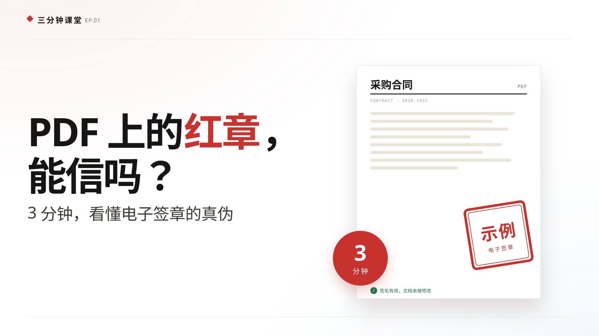

# EP.01 · PDF 上的红章，能信吗？

## 一句话

红章只是外观；真正能证明文件没被改过、也确实是你签的，是 PDF 里的数字签名和 CA 证书。

## 章节

| 时间 | 内容 |
|---|---|
| 00:00 | 开场：星河科技收到带红章的合同 |
| 00:15 | 法律：法律认的是可靠的电子签名 |
| 00:33 | 原理：采购合同、100 万、SHA-256 |
| 00:47 | 改一个字：100 万 → 900 万，哈希变化，验签失败 |
| 00:59 | 证书：CA 是数字身份证的签发处 |
| 01:23 | 签章：签名、证书、时间戳写进 PDF |
| 01:47 | 验签：原件绿勾，改字红叉 |
| 02:07 | 三个坑：截图、改字、证书过期 |
| 02:32 | 收束：记住三看 |

## 文件

| 文件 | 说明 |
|---|---|
| [out/pdf-ca-signature.mp4](out/pdf-ca-signature.mp4) | 成片，2:43，1080p30，H.264 + AAC |
| [slides/index.html](slides/index.html) | 网页播放器，也是渲染源 |
| [slides/data.js](slides/data.js) | 由 `pipeline/tts.py` 生成的时间轴与字幕 |
| [script.md](script.md) | 分镜、口播稿、事实核对 |
| [research/notes.md](research/notes.md) | 法律与技术细节笔记 |
| [audio/narration.m4a](audio/narration.m4a) | 拼接后的完整配音 |
| [audio/manifest.json](audio/manifest.json) | 场景起点、时长、逐句字幕 |
| [subtitles/pdf-ca-signature.srt](subtitles/pdf-ca-signature.srt) | 上传 B 站时可作为 CC 字幕 |
| [cover/cover.svg](cover/cover.svg) | 矢量封面 |
| [cover/cover.html](cover/cover.html) | 封面设计源文件（可生成 B 站用 PNG） |

## 制作说明

- 配音：`zh-CN-YunxiNeural`，语速 `+15%`，逐场合成后按 0.35s 间隔拼接，最终响度归一化。
- 画面：第一版白底结构；标题 70–110px，正文 30–38px，字幕 46px。
- 案例：星河科技（甲方）与云海供应链（乙方）的采购合同；100 万/900 万；哈希 6364…/0e72…。哈希值是对示例合同文本计算的 SHA-256，用于演示，真实 PDF 签名的哈希针对 PDF 字节范围。
- 动画：人物、合同、红章、钥匙、锁、证书、时钟等简单图标；物体移动、箭头画出、盖章、绿勾弹出。所有动画在每场前 4 秒完成，之后保持静止供旁白讲解。
- 结构：9 场，保留第一版的法律引文、四个条件、CA 证书和验签面板；新增“改一个字”整场，展示哈希变化和红叉失败。
- 时间轴：`audio/manifest.json` 是唯一时间来源；改旁白后重新跑 `make audio`。

## 注意

本片是科普，不构成法律意见。片中「截图 / 打印件不是可靠的电子签名」指该图片本身不能单独证明签名有效；打印件仍可能作为其他证据使用。不同 CA、不同 PDF 阅读器、不同国密算法版本的验签表现可能不同；真实合同请以 CA 或第三方验签平台的报告为准。
